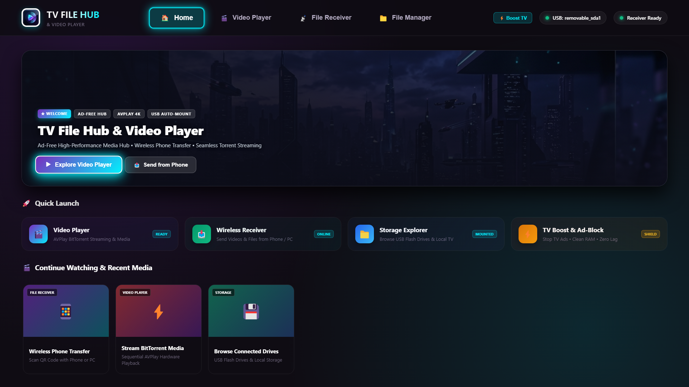
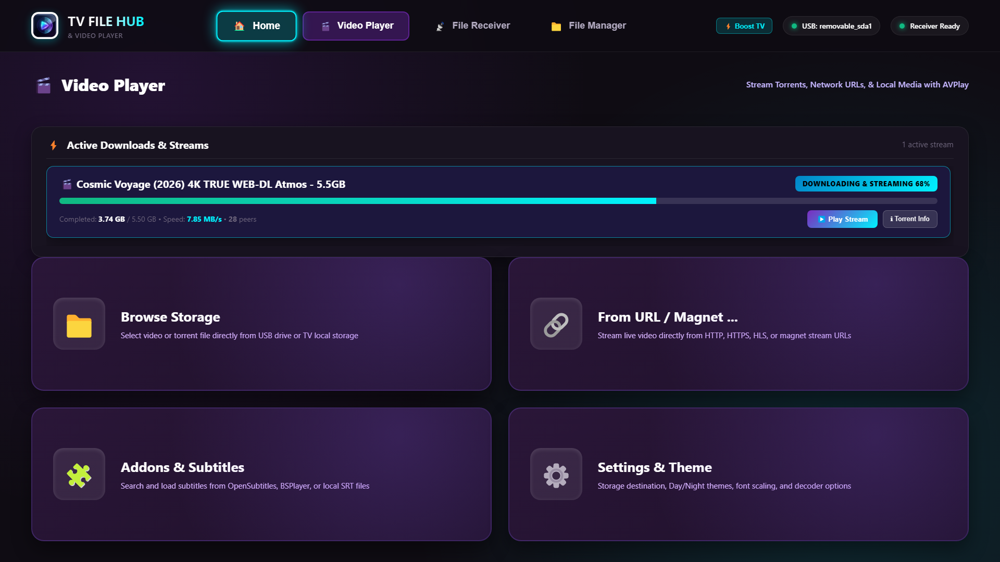
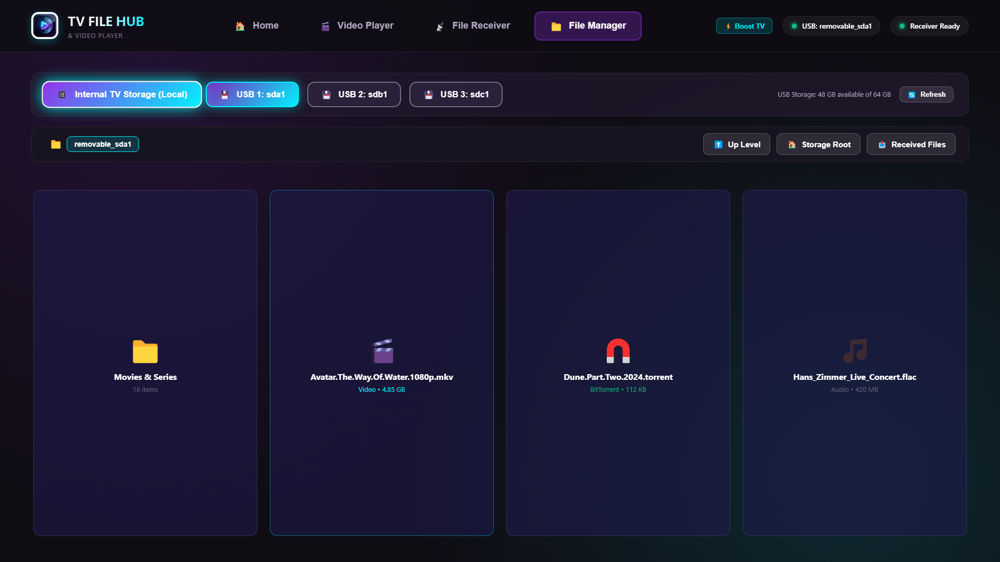
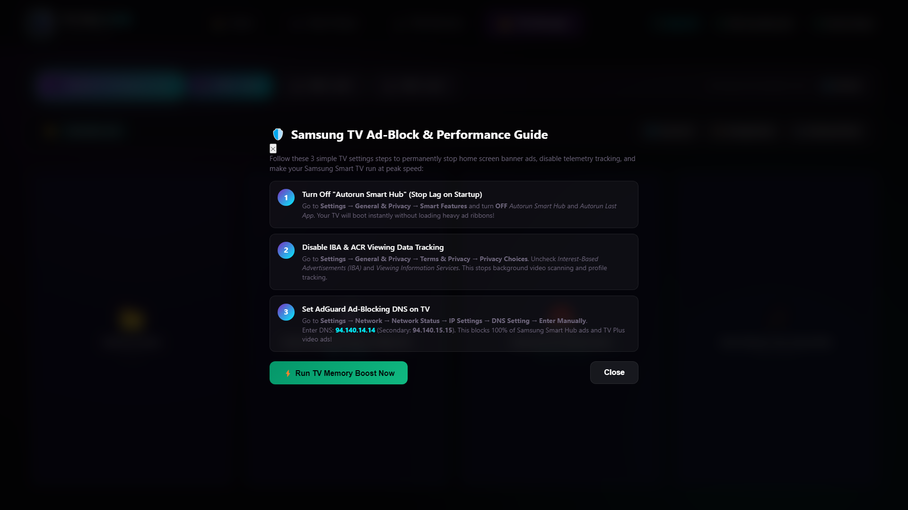

# 🎬 Samsung Tizen Smart TV: TV File Hub & Video Player

[](https://developer.samsung.com/smarttv)
[](https://developer.samsung.com/smarttv/develop/api-references/samsung-product-api-references/avplay.html)
[](https://webtorrent.io)
[](LICENSE)

An all-in-one, high-performance multimedia suite designed exclusively for the 10-foot living room experience on **Samsung Crystal UHD, QLED, Neo QLED, and OLED Smart TVs** running **Tizen OS (3.0 through 10.0+)**.

Combines **Sequential BitTorrent video streaming**, **zero-buffer hardware-accelerated playback with Samsung AVPlay**, **ultra-fast peer-to-peer wireless file transfer from smartphones and computers**, **multi-drive USB file explorer**, and an **integrated TV performance booster & ad-blocker dashboard**.

---

## 📸 Screenshots Showcase

### 1. 🏠 Modern Cinematic Home Launcher
*Apple TV / Google TV-inspired dashboard featuring hero spotlight banners, quick-launch application modules, and a live Continue Watching carousel.*



---

### 2. 🎬 Video Player & Sequential Torrent Streamer
*Hardware-accelerated media hub with live BitTorrent swarm telemetry (peers, download speed, verified progress bar, remaining time) and direct subtitle search.*



---

### 3. 📡 Wireless LAN File Receiver
*High-contrast offline QR code for instant smartphone camera pairing, local network IP resolver, and real-time multi-file transfer queue.*


---

### 4. 📁 Multi-Drive USB Storage & Media Browser
*Independent selectable storage tabs for Internal Flash and multiple attached USB drives (`USB 1: sda1`, `USB 2: sdb1`, `USB 3: sdc1`), live disk capacity indicators, and breadcrumb folder navigation.*



---

### 5. 🛡️ Samsung TV Ad-Blocker & Memory Booster Guide
*Step-by-step guide to stop Smart Hub startup lag, disable background telemetry tracking, configure AdGuard ad-blocking DNS, and purge TV RAM with a single click.*



---

### 6. 📱 Responsive Mobile & PC Web Sender Interface
*Zero-install drag-and-drop web uploader that opens instantly in any browser when scanning the TV screen QR code.*


---

## ✨ Key Features

### 🎬 Sequential BitTorrent Streaming Engine
- **Stream as You Download:** Sequential piece prioritization streams video in real time while downloading the remainder of the file in the background.
- **Hardware Acceleration:** Feeds live streams directly into the native Samsung `webapis.avplay` hardware decoder, providing 4K/1080p playback with zero frame drops.
- **Cryptographic `.done` Verification:** Automatically validates SHA-1 piece checksums upon completion and transitions seamlessly to direct high-speed HTTP streaming.
- **Resilient Timeline Seeking:** Seek forward or backward by ±10 seconds or scrub anywhere along the timeline with RFC 7233 byte-range serving.

### 📡 Wireless Local Wi-Fi File Transfer
- **Zero Mobile App Required:** Phone and laptop users simply scan the QR code displayed on the TV to open the mobile web sender.
- **High-Speed LAN Transfer:** Direct local network streaming with multi-gigabyte video support (MKV, MP4, AVI, WEBM, MOV, FLAC, MP3, Torrent files).
- **Auto-Versioning & Storage Safety:** Prevents accidental overwrites by automatically numbering duplicate filenames (`movie (1).mkv`).
- **Queue Management:** Top-bar action buttons allow clearing the queue list or deleting all received files from physical disk in one click.

### 📁 Multi-Drive USB Storage Manager
- **Multi-USB Support:** Automatically detects and displays individual tabs for every plugged-in USB storage partition alongside TV Internal memory.
- **Live Disk Capacity Gauges:** Displays free and total gigabytes for every connected drive in real time.
- **Deep File Tree Traversal:** Instant breadcrumbs navigation, parent folder jump (`Up Level`), root directory return (`Storage Root`), and quick jump to `Received Files`.

### 🛡️ Smart Hub Ad-Blocker & Performance Optimization
- **Startup Lag Elimination:** Disables heavy Smart Hub ad ribbon preloading to enable instantaneous TV boot times.
- **Telemetry & IBA Shield:** Guides users to disable Interest-Based Ads (IBA) and ACR profile tracking.
- **Network-Level Ad Blocking:** Simple setup for AdGuard DNS (`94.140.14.14` / `94.140.15.15`) to eliminate 100% of TV banner and video ads.
- **One-Click RAM Purge:** Frees TV memory buffers and restarts UI rendering pipelines on demand.

### 🎨 10-Foot Living Room Design
- **Day & Night Themes:** High-contrast Dark (OLED glassmorphism) and Day (Clean Light) color palettes.
- **Customizable Font Scaling:** Standard (100%), Large (115%), and Extra Large (130%) for comfortable reading across living rooms.
- **Samsung Remote Optimization:** 2D spatial navigation designed for physical D-pad remotes (Samsung Smart Remote and traditional infrared remotes).

---

## 📦 Repository Structure

```text
├── app/                                 # Samsung Tizen Web Application
│   ├── config.xml                       # Tizen application manifest & privileges
│   ├── index.html                       # 10-foot TV user interface layout
│   ├── icon.png                         # High-res 512x512 TV launcher icon
│   ├── assets/                          # UI backdrop graphics and artwork
│   ├── css/
│   │   └── style.css                    # Day/Night themes, spatial focus glow states
│   └── js/
│       ├── navigation.js                # 2D spatial navigation & TV remote key handling
│       ├── filesystem.js                # Multi-USB detection & storage preference engine
│       ├── player.js                    # Samsung AVPlay hardware decoding pipeline
│       ├── videoplayer.js               # BitTorrent download tracking & player HUD
│       ├── receiver.js                  # File receiver queue, QR generator & actions
│       ├── filemanager.js               # USB storage browser & breadcrumb navigator
│       ├── home.js                      # Spotlight banner & continue watching carousel
│       └── qrcode.min.js                # Offline QR code generator for TV screen
├── build/
│   └── TVFileHub.wgt                    # Pre-compiled, production-ready Tizen TV package (v1.0.9)
├── server/                              # Companion Host Bridge Server
│   ├── server.py                        # Lightweight HTTP & WebSocket transfer server
│   ├── torrent_engine.mjs               # WebTorrent sequential streaming daemon
│   └── public/
│       └── sender.html                  # Responsive mobile & desktop drag-and-drop web uploader
├── tools/                               # Packaging & deployment utilities
│   ├── apps2samsung/                    # CLI tool for deploying .wgt to Samsung TVs
│   └── generate_screenshots.py          # Automated Playwright documentation screenshot script
├── build.py                             # Tizen widget packaging & validation script
├── deploy.ps1                           # Automated PowerShell deployment script
├── .gitignore                           # Git exclusion rules (no test movies or media files)
└── README.md                            # Comprehensive technical documentation & user manual
```

---

## 🛠️ Installation Guide

### Prerequisites
1. **Samsung Smart TV** (2017+ model running Tizen OS 3.0, 4.0, 5.0, 6.0, 7.0, 8.0, 9.0, or 10.0+).
2. **Computer** (Windows, macOS, or Linux) connected to the **same Wi-Fi or Ethernet network** as your TV.
3. **Python 3.10+** & **Node.js 18+** installed on your computer.

---

### Step 1: Enable Developer Mode on your Samsung TV
1. Turn on your TV and press the **Home** button on your remote.
2. Navigate to the **Apps** panel.
3. On your remote control, press the number sequence: **`1` `2` `3` `4` `5`** in order.
4. A **Developer Mode Configuration** dialog will appear:
   - Toggle **Developer Mode** to **ON**.
   - In **Host PC IP**, enter your computer's local IP address (e.g. `192.168.0.13`).
5. Select **OK**.
6. **Reboot your TV**: Press and hold the **Power** button on your remote for 5 seconds until the Samsung logo appears (or unplug the TV power cord for 10 seconds).

---

### Step 2: Install the Pre-Built App onto your TV

This repository comes with the pre-compiled widget: [`build/TVFileHub.wgt`](build/TVFileHub.wgt).

#### Option A: Quick Install via `apps2samsung-cli` (Windows)
Open PowerShell in the project directory and run:
```powershell
.\tools\apps2samsung\apps2samsung-cli.exe install build\TVFileHub.wgt --tv <YOUR_TV_IP> --launch --plain
```
*(Replace `<YOUR_TV_IP>` with your TV's IP, e.g. `192.168.0.12`)*

#### Option B: Install via Samsung Tizen SDB (All Platforms)
```bash
# 1. Connect to your TV
sdb connect <YOUR_TV_IP>:26101

# 2. Install the package
sdb install build/TVFileHub.wgt
```

---

### Step 3: Start the Companion Transfer & Streaming Bridge

#### Option A: Docker Deployment (Recommended for Raspberry Pi, Linux, NAS & HomeLab)
```bash
cd server
docker compose up -d
```
The containerized service automatically sets up the Node.js WebTorrent sequential streaming daemon, Python 3 companion bridge, persistent volume mounts (`uploads/` and `downloads/`), and health checks on port 8080.

#### Option B: Direct Python & Node.js Execution
In your terminal or command prompt, navigate to the project directory and run:
```bash
python server/server.py
```

The bridge server will initialize:
```text
================================================================
   TV FILE HUB & BITTORRENT STREAMING BRIDGE
================================================================
  Server Host IP: 192.168.0.13
  HTTP File Port: 8080
  Streaming Port: 8889 (BitTorrent Sequential Streamer)
  Web Sender UI:  http://192.168.0.13:8080/
================================================================
```

---

### Step 4 (Optional): Building from Source
If you make code modifications or wish to rebuild the package:
```bash
python build.py
```
This validates all required files and builds a fresh `build/TVFileHub.wgt`.

---

## 📖 User Guide & Daily Usage

### 1. Transferring Videos and Torrents from Smartphone or PC
1. Launch **TV File Hub** on your Samsung TV.
2. Navigate to the **File Receiver** tab.
3. Point your smartphone's camera at the **QR Code** on screen (or type the displayed IP into any web browser on your Wi-Fi).
4. Tap **Select Files to Send** or drag and drop any file:
   - Video files (`.mkv`, `.mp4`, `.avi`, `.mov`, `.webm`)
   - BitTorrent files (`.torrent`)
   - Subtitles (`.srt`, `.vtt`)
   - Music & Photos
5. The TV screen displays a live progress bar. Files are saved directly to your default storage location (e.g. attached USB drive).

---

### 2. Streaming BitTorrent Movies
- **Instant Playback:** When a `.torrent` file is received or selected from storage, select **Play Stream**.
- The companion engine immediately starts sequential buffering and streams video directly to the TV's AVPlay hardware player.
- Watch movies instantly from the start without waiting for gigabytes of data to finish downloading.
- The player displays live torrent health (peer count, download speed, percentage completed).
- When the torrent completes, it verifies all data hashes and saves the completed media file permanently to your storage.

---

### 3. Playing Videos from Connected USB Drives
1. Plug any USB flash drive or external hard drive into the USB port of your Samsung TV.
2. Open the **File Manager** tab.
3. Select your drive pill (`USB 1: sda1`, `USB 2: sdb1`, etc.).
4. Browse folders using the remote D-pad.
5. Press **Enter** on any video file to enjoy hardware-accelerated playback with full timeline scrub support.

---

### 4. Customizing Themes & Font Size
1. Navigate to the **Video Player** tab.
2. Click on **Settings & Theme**.
3. Customize:
   - **Default Storage Location:** Choose between `Auto (Prefer USB)`, `Internal TV Storage`, or a specific USB drive.
   - **Auto Background Downloads:** Toggle whether received torrent files automatically begin downloading in the background.
   - **Theme:** Switch between **Night Mode** (Dark violet glassmorphism) and **Day Mode** (Crisp clean light).
   - **Font Scaling:** Standard (100%), Large (115%), or Extra Large (130%).

---

## 🎮 Samsung TV Remote Control Reference

| Button | Function |
| :--- | :--- |
| **D-Pad (Up / Down / Left / Right)** | Move focus across navigation tabs, feature cards, storage pills, and buttons |
| **Enter / OK (Center Button)** | Activate selected item, open folder, start video stream, or confirm dialogs |
| **Return / Back** | Close active modals, navigate to parent folder, or exit video player |
| **Play / Pause** | Toggle video playback during streaming |
| **Left / Right (During Playback)** | Seek backward / forward by 10 seconds |
| **Fast Forward / Rewind** | Continuous fast seeking along the timeline |
| **Color Keys (Red / Green / Yellow / Blue)** | Quick actions inside player and file explorer |

---

## 🔒 Privacy & Security

- **100% Local Network Communication:** All file transfers and video streams occur strictly within your private home Wi-Fi network (`LAN`).
- **Zero Cloud Relay:** Files never touch external servers or third-party cloud intermediaries.
- **Zero Advertising & Telemetry:** Built from the ground up to give Samsung Smart TV owners an ad-free, private, high-performance media environment.

---

## 📄 License

Distributed under the **MIT License**. See `LICENSE` for more information.

---

*Created for Samsung Smart TV & Tizen OS enthusiasts.*
