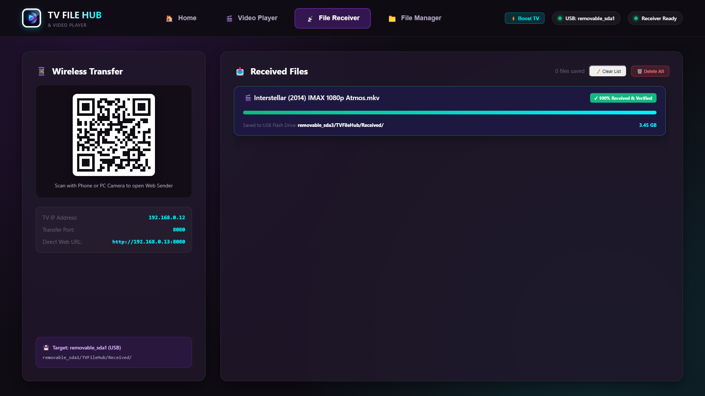
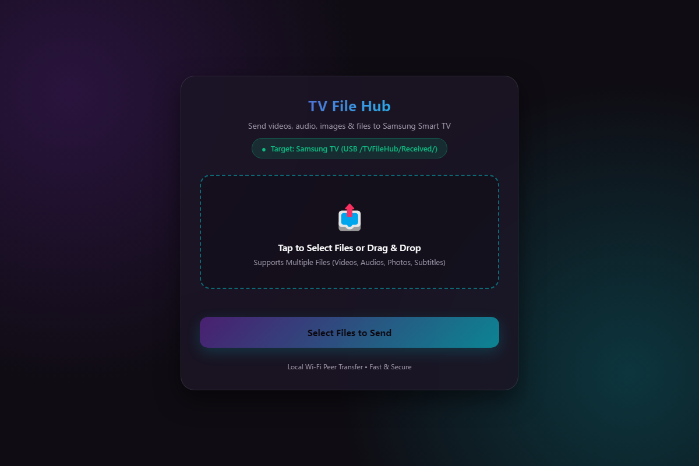

# 🎬 LinkPlay (Multi-Platform Media & File Ecosystem)

[](https://developer.samsung.com/smarttv)
[](https://developer.android.com/tv)
[](https://developer.android.com)
[](https://developer.android.com/training/cars/apps)
[](https://developer.apple.com/ios/)
[](https://developer.samsung.com/smarttv)
[](https://developer.android.com/media/media3)
[](https://webtorrent.io)
[](LICENSE)

**LinkPlay** is an all-in-one, high-performance multimedia and file synchronization ecosystem unifying **Samsung Smart TVs (Tizen OS 3.0 to 10.0+)**, **Android TV & Google TV**, **Android Smartphones & Tablets**, **Apple iPhone & iPad (iOS)**, and **Android Auto** into one private, high-speed local network media hub.

All clients connect to a lightweight, zero-dependency **Companion Server** running inside your home network. LinkPlay provides instant sequential BitTorrent video streaming, real-time wireless file transfers with offline vector SVG QR codes, multi-drive USB storage exploration, automatic MKV Cues index repair for instant TV seeking, and deterministic 10-foot remote control navigation.

---

## 📱 Supported Platforms & Ecosystem

| Platform | Technology Stack | UI / Experience | Key Capabilities | Package ID / Target |
| :--- | :--- | :--- | :--- | :--- |
| **Samsung Smart TV** | Tizen Web API + Samsung AVPlay | 10-foot Cinematic Living Room UI, D-pad remote navigation | Hardware-accelerated 4K decoders, multi-drive USB explorer, live torrent streaming, TV ad-block & memory boost. | `YGDS1qv5fm.TVFileHub`<br>`build/TVFileHub.wgt` |
| **Android TV / Google TV** | Kotlin + Jetpack Compose for TV / Leanback | Native 10-foot TV UI, D-pad spatial focus | ExoPlayer Media3 4K playback, dynamic LAN server discovery, torrent streaming, TV launcher banner. | `com.tvfilehub.tv`<br>`android/tv/` |
| **Android Phone / Tablet** | Kotlin + Jetpack Compose Material 3 | Responsive touch UI, portrait & landscape auto-rotation | Mobile player, episode selection dialog, drag-and-drop transfer, background sync with WorkManager. | `com.tvfilehub.phone`<br>`android/phone/` |
| **Apple iPhone / iPad** | Swift 5.0 + SwiftUI + AVKit / AVPlayer | Native iOS touch UI, Picture-in-Picture, AirPlay | Native AVPlayer streaming, document uploader, episode picker, offline PWA Web Clip support. | `com.tvfilehub.linkplay`<br>`ios/LinkPlay.xcodeproj` |
| **Android Auto** | Android for Cars App Library + MediaLibraryService | Driver-safety compliant in-car media interface | Audio media browsing, playlist queues, high-fidelity car head unit streaming via MediaSession with auto focus. | `com.tvfilehub.auto`<br>`android/auto/` |
| **Web Sender & Dashboard** | HTML5, CSS3 Glassmorphism, Vanilla JS, WebSockets | Responsive web portal for desktop, tablet, and mobile | Zero-install drag-and-drop uploader, live download speeds, pause/resume, stream first, low priority toggle. | `http://<SERVER_IP>:8080/`<br>`server/public/` |

---

## 📸 Screenshots & Visual Tour

### 1. 🏠 Cinematic TV Home Launcher
*Apple TV & Google TV-inspired dashboard featuring hero spotlight banners with 1-click play/resume, live Continue Watching carousel with progress bars, and the Companion Bridge Network widget with an instant vector SVG QR code.*


---

### 2. 🎬 Video Player Hub & Sequential Torrent Streamer
*Hardware-accelerated media hub with live BitTorrent swarm metrics (peer count, download speed, uploaded bytes, verified piece progress, ETA), episode selector dialog, and subtitle search.*


---

### 3. 📡 Wireless LAN File Receiver
*High-contrast offline vector SVG QR code for instant smartphone camera pairing, local network IP resolver, target storage toggle, and real-time multi-file transfer queue.*



---

### 4. 📁 Multi-Drive USB Storage & Media Browser
*Multi-mount partition selector (`USB 1: sda1`, `USB 2: sdb1`, `USB 3: sdc1`), local TV flash storage, capacity gauges, breadcrumb directory traversal, and 1-click playback.*


---

### 5. 🛡️ TV Performance Booster & Ad-Blocker Guide
*Interactive walkthrough to stop Smart Hub startup lag, disable background telemetry tracking, configure AdGuard ad-blocking DNS, and purge TV RAM with a single click.*


---

### 6. 📱 Responsive Mobile & PC Web Sender Interface
*Zero-install drag-and-drop web uploader that opens automatically when scanning the TV screen QR code with your mobile camera or entering the local server IP.*



---

## ✨ Key Features & Innovations

### 🎬 Sequential BitTorrent Streaming Engine
- **Stream as You Download:** Piece prioritization downloads the beginning and end of the video first, enabling instant 4K playback while the remainder downloads sequentially in the background.
- **Hardware Acceleration:** Feeds streams directly into Samsung's native AVPlay decoder pipeline on Tizen and Media3 ExoPlayer on Android TV for butter-smooth 60 FPS playback.
- **Automatic MKV Cues Repair:** In-flight MKV indexer parses and patches missing EBML Cues on the fly, unlocking instant timeline seeking across TVs and media players without waiting for downloads to finish.
- **Real-Time Swarm Telemetry:** Displays peer count, download speed, upload speed, progress percentage, downloaded/total MB, and remaining ETA.

### 📺 Multi-Episode Series Support & Queue Priority
- **Embedded Episode Selector:** Multi-file torrents (e.g. TV seasons, anime series) display an interactive episode modal so you can choose and stream individual episodes immediately while downloading.
- **Priority Queue Scheduling:** Three-tier scheduling:
  - **Highest Priority (⚡ Streaming):** Allocates full network bandwidth to the video currently playing.
  - **Normal Priority:** Standard background downloading queue.
  - **Low Priority:** Defers bulk torrents to download only after all other active items complete.
- **Download Controls:** Pause, resume, restart, and delete downloads directly from the TV app or mobile web dashboard.

### 🎮 Deterministic 10-Foot Remote Navigation
- **Header Tab Focus Retention:** Pressing **ENTER** or clicking any navigation tab (Home, Video Player, File Receiver, File Manager) activates the view, resets the scroll position to the top, and strictly preserves focus on that tab. Focus moves down into view contents only when the user explicitly presses the **DOWN** arrow key on the remote.
- **Universal Top Scrolling:** Switching tabs or re-selecting the active tab automatically scrolls `window`, `document`, and scrollable list containers (`#view-home`, `.queue-list`, `.player-downloads-list`, `.file-grid`) to `scrollTop = 0`.
- **Zero Off-Axis Drift:** Rigid boundary clamps keep coordinates locked at (0, 0), eliminating screen jumping.

### 📡 Offline Vector SVG QR Code Engine
- **Crisp Vector Rendering:** Generates vector `<svg>` elements directly in the DOM, eliminating legacy canvas blank-image issues inside hidden containers on Tizen WebKit.
- **Dual Placement:** Displays in full 140x140px on the **File Receiver** tab and in 76x76px directly inside the **Home Dashboard Companion Bridge Network widget** for instant phone camera scanning.

### 💾 Storage Target Flexibility
- **Save Anywhere:** Toggle received file targets between:
  - **Attached USB Storage:** Saves directly to connected flash drives (`<label>/TVFileHub/Received/`).
  - **Local TV Flash:** Stores locally on internal TV storage (`downloads/TVFileHub/Received/`).
  - **Server Storage (Zero TV Space):** Keeps all heavy media on the Companion Server (`/app/uploads/`), consuming 0 MB of TV memory while streaming seamlessly.

---

## 📦 Project Architecture

```text
LinkPlay/
├── app/                                 # Samsung Tizen Web Application (v1.1.8)
│   ├── config.xml                       # Tizen application manifest & privileges
│   ├── index.html                       # 10-foot TV user interface layout
│   ├── icon.png                         # High-res 512x512 TV launcher icon
│   ├── assets/                          # Backdrop artwork & graphics
│   ├── css/
│   │   └── style.css                    # Day/Night themes, focus glow states, responsive layouts
│   └── js/
│       ├── app.js                       # Main orchestrator, view lifecycle & scroll manager
│       ├── navigation.js                # Remote D-pad spatial navigation & key bindings
│       ├── home.js                      # Home dashboard, Hero banner & continue watching
│       ├── videoplayer.js               # Video Player hub, priority queue & torrent metrics
│       ├── player.js                    # AVPlay hardware decoder & HTML5 fallback engine
│       ├── receiver.js                  # File Receiver, WebSocket listener & SVG QR code
│       ├── filesystem.js                # Tizen filesystem abstraction & USB mount monitor
│       ├── filemanager.js               # Multi-drive USB storage explorer & directory grid
│       └── qrcode.min.js                # Vector SVG-enabled QR code generator
│
├── android/                             # Android Multi-Module Gradle Project
│   ├── core/                            # Shared Android Core Library
│   │   ├── common/                      # ByteFormatter, NetworkUtils, Result monad, QrCode
│   │   ├── network/                     # Retrofit REST API, OkHttp, WebSocket listener
│   │   ├── database/                    # Room DB, MediaDao, ResumePoint & Cache entities
│   │   ├── models/                      # DownloadItem, TorrentStats, SystemStatus, FileNode
│   │   ├── repository/                  # MediaRepository, TorrentRepository, TransferRepository
│   │   └── services/                    # MediaPlaybackManager, LocalMediaScanner
│   ├── tv/                              # Native Android TV & Google TV Application
│   │   ├── navigation/                  # TvNavHost, TvDestination
│   │   └── ui/                          # 10-foot Compose UI, D-pad focus cards, TV OSD player
│   ├── phone/                           # Native Android Phone Application
│   │   ├── navigation/                  # PhoneNavHost, Screen definitions
│   │   ├── ui/                          # Material 3 UI, Home, Video Player, Explorer, Transfer
│   │   └── workers/                     # WorkManager background download sync
│   ├── auto/                            # Android Auto Automotive Media Experience
│   │   ├── service/                     # CarMediaLibraryService (MediaLibraryService / MediaSession)
│   │   └── car/                         # CarMediaScreen (Android for Cars App Library)
│   ├── build.gradle.kts                 # Root Gradle Kotlin DSL build script
│   └── settings.gradle.kts              # Multi-module inclusion (:core, :tv, :phone, :auto)
│
├── ios/                                 # Apple iPhone & iPad Native iOS Project (iOS 16+)
│   ├── LinkPlay.xcodeproj               # Xcode project file
│   └── LinkPlay/
│       ├── App/LinkPlayApp.swift        # SwiftUI application entry point
│       ├── Models/Models.swift          # Codable data models matching Server API
│       ├── Services/ServerAPI.swift     # Async/await URLSession networking engine
│       ├── Views/
│       │   ├── ContentView.swift        # Main bottom tab navigation
│       │   ├── HomeScreen.swift         # Cinematic dashboard with hero spotlight
│       │   ├── PlayerHubView.swift      # Searchable movie library with 1-click streaming
│       │   ├── VideoPlayerView.swift    # Hardware AVPlayer with Picture-in-Picture & AirPlay
│       │   ├── DownloadsView.swift      # Live BitTorrent queue & series episode picker
│       │   ├── TransferView.swift       # Wireless LAN document & photo uploader
│       │   └── SettingsView.swift       # Companion server connection & latency tester
│       └── Info.plist                   # Local network & background audio configuration
│
├── server/                              # Companion Host Bridge Server
│   ├── server.py                        # Python 3 HTTP/WebSocket daemon & priority scheduler
│   ├── torrent_engine.mjs               # Node.js sequential BitTorrent streaming engine
│   ├── Dockerfile                       # Container definition with Python 3 & Node.js
│   ├── docker-compose.yml               # Production deployment specification
│   ├── requirements.txt                 # Python dependencies
│   ├── package.json                     # Node.js dependencies (webtorrent, etc.)
│   └── public/
│       ├── dashboard.html               # Real-time Web Download Dashboard
│       └── sender.html                  # Mobile & Desktop Web Sender UI
│
├── shared/                              # Shared Specifications & Configurations
│   ├── api-contracts/                   # JSON Schema API contract (server-api-v1.json)
│   ├── configurations/                  # Default ports, timeouts, buffer sizes (default_config.json)
│   └── documentation/                   # Complete API_SPECIFICATION.md
│
├── docs/                                # Multi-Platform Engineering Documentation
│   ├── EXISTING_ARCHITECTURE.md         # Exhaustive analysis of Tizen & Server internals
│   ├── FEATURE_INVENTORY.md             # Complete catalog of features, models & actions
│   ├── PLATFORM_COMPATIBILITY.md        # Feature parity & automotive policy feasibility analysis
│   └── images/                          # High-resolution screenshots
│
├── scripts/                             # Multi-Platform Build & Verification Automation
│   ├── build_tizen.ps1                  # Packages Tizen TV application (build/TVFileHub.wgt)
│   ├── deploy_tizen.ps1                 # Automated signing, installation & launch on Samsung TV
│   ├── build_android.ps1                # Builds Phone, TV, and Auto APKs via Gradle
│   ├── install_device.ps1               # ADB deployment helper for Android phones & TVs
│   ├── install_tablet.ps1               # Remote deployment helper for Android tablets
│   ├── build_all.ps1                    # Master multi-platform build pipeline
│   └── test_all.ps1                     # Test runner executing unit & integration suites
│
├── build.py                             # Tizen widget packaging & validation script
└── build/
    └── TVFileHub.wgt                    # Pre-built, verified Samsung Tizen package (v1.1.8)
```

---

## 🚀 Quick Start Guide

### Step 1: Start the Companion Server
Run the companion bridge on any local machine (PC, Server, Laptop, NAS, or HomeLab).

#### Option A: Docker Deployment (Recommended)
```bash
cd server
docker compose up -d
```

#### Option B: Standalone Execution
```bash
# Install Python & Node.js dependencies
cd server
pip install -r requirements.txt
npm install

# Start the bridge server
python server.py
```

The server initializes on port `8080` (HTTP/WebSocket) and port `8889` (Sequential Streaming):
```text
================================================================
 LinkPlay - Companion Transfer Bridge
 Bound Interface:       0.0.0.0:8080
 Web Sender running at: http://localhost:8080/
 Network Sender URL:    http://192.168.0.14:8080/
 Torrent Stream Port:   8889
 Storage Directory:     D:\PY\SamsungTV\server\uploads
================================================================
```

---

### Step 2: Deploy to Samsung Smart TV
Make sure your Samsung TV and computer are connected to the same Wi-Fi network and Developer Mode is enabled on the TV.

#### One-Click Automated Deployment
```powershell
.\scripts\deploy_tizen.ps1 -TV_IP 192.168.0.12
```

#### Manual Installation via Apps2Samsung CLI
```bash
# 1. Package the widget
python build.py

# 2. Install and launch on TV
tools\apps2samsung\apps2samsung-cli.exe install build\TVFileHub.wgt --tv 192.168.0.12 --launch --plain -y
```

---

### Step 3: Run Android Applications

#### Build All Android Targets
```bash
cd android
./gradlew assembleDebug
```

#### Build Specific Targets
```bash
# Android TV & Google TV
./gradlew :tv:assembleDebug

# Android Phone
./gradlew :phone:assembleDebug

# Android Auto Module
./gradlew :auto:assembleDebug
```

#### Deploy to Connected Android Device via ADB
```powershell
.\scripts\install_device.ps1 -Target phone
# or
.\scripts\install_device.ps1 -Target tv -DeviceIP 192.168.0.25
```

---

### Step 4: Run Apple iPhone & iPad App

#### Option A: Native iOS Project (Xcode)
1. Open `ios/LinkPlay.xcodeproj` in Xcode on macOS.
2. Select your target device (iPhone or iPad running iOS 16.0+).
3. Press **Cmd + R** to run on Simulator or your physical iPhone.
- Includes native hardware AVPlayer, Picture-in-Picture, AirPlay to Apple TV, wireless file transfer, and series episode selection.

#### Option B: Zero-Install Instant iPhone Web App (PWA)
1. Point your iPhone camera at the QR code on the TV screen (or open `http://<SERVER_IP>:8080/` in Safari).
2. Tap the **Share** button in Safari and select **Add to Home Screen**.
3. LinkPlay launches as a standalone, full-screen app icon directly on your iPhone home screen with offline caching!

---

### Step 5: Access Web Sender & Download Dashboard
Open any browser on your phone, tablet, or PC:
- **Web Sender:** `http://<SERVER_IP>:8080/` — Drag and drop `.torrent`, `.mkv`, `.mp4`, or subtitle files.
- **Web Dashboard:** `http://<SERVER_IP>:8080/downloads` — Monitor live downloads, select episodes, pause/resume, and stream.

---

## 🛠️ Build & Verification Automation

| Task | Command | Description |
| :--- | :--- | :--- |
| **Build Tizen Package** | `python build.py` or `.\scripts\build_tizen.ps1` | Validates package integrity and outputs `build/TVFileHub.wgt`. |
| **Deploy to TV** | `.\scripts\deploy_tizen.ps1 -TV_IP <IP>` | Connects to TV, signs package, installs, and launches. |
| **Build Android** | `.\scripts\build_android.ps1 -Target all` | Compiles Android Phone, TV, and Auto APKs. |
| **Build All Platforms** | `.\scripts\build_all.ps1` | Master pipeline building both Tizen and Android deliverables. |
| **Run Test Suites** | `.\scripts\test_all.ps1` | Executes package checks and Android `:core` unit tests. |

---

## 🎮 Samsung TV Remote Control Reference

| Remote Button | Normal Navigation | Video Playback Mode |
| :--- | :--- | :--- |
| **D-Pad Up / Down** | Move vertical focus across tabs, cards, and buttons | Show OSD / Focus timeline controls |
| **D-Pad Left / Right** | Switch navigation tabs / Horizontal carousel cards | Seek backward / forward 10 seconds |
| **Enter / OK (Center)** | Activate selected item (Enter on tab keeps tab focused) | Toggle Play / Pause |
| **Return / Back** | Close open modals / Return to previous view | Exit video playback and return to hub |
| **Play (Hardware)** | — | Resume playback |
| **Pause (Hardware)** | — | Pause playback |
| **Stop (Hardware)** | — | Stop video and exit player |
| **Fast Forward / Rewind** | — | Scrub along timeline |
| **Red Key** | Refresh active list / Rescan storage | Aspect ratio cycle (Fit, Zoom, Full, 4:3, 21:9) |
| **Green Key** | Open Storage Selector dialog | Open Audio Track selector modal |
| **Yellow Key** | Open Direct URL / Stream dialog | Toggle Subtitles on / off |
| **Blue Key** | Open TV Performance & Ad-Block Guide | Open Subtitle Search modal |

---

## 🌐 Companion Server API Endpoints

| Endpoint | Method | Description |
| :--- | :--- | :--- |
| `/api/downloads` or `/downloads` | `GET` | Returns list of active downloads, completed movies, and swarm stats. |
| `/upload` | `POST` | Multipart upload for video files, torrents, and subtitles. |
| `/play_torrent?file=<name>` | `GET` | Starts sequential torrent stream and returns streaming status. |
| `/torrent_files?file=<name>` | `GET` | Returns individual file/episode list within multi-file torrents. |
| `/stream_torrent_file?torrent=<t>&file=<i>` | `GET` | Streams specific episode by index over HTTP 1.1 Partial Content. |
| `/pause_download?file=<name>` | `GET` | Pauses active torrent download. |
| `/resume_download?file=<name>` | `GET` | Resumes paused torrent download. |
| `/restart_download?file=<name>` | `GET` | Restarts stalled download. |
| `/set_torrent_priority?file=<name>&priority=<p>` | `GET` | Sets priority: `highest` (stream), `normal`, or `low`. |
| `/delete_file?file=<name>` | `GET` | Deletes file or torrent entry from server. |
| `/files/<filename>` | `GET` | HTTP 1.1 Partial Content range stream with MKV Cues repair. |
| `/ws` | `WebSocket` | Real-time RFC 6455 push events (`torrent_progress`, `upload_status`). |

---

## 🔒 Privacy & Security

- **100% Local Network Communication:** All media streams, WebSocket telemetry, and file transfers operate strictly within your local home network (`LAN`).
- **Zero Cloud Intermediaries:** Files and playback tokens never touch external servers or third-party cloud infrastructure.
- **Zero Advertising & Telemetry:** Built from the ground up to provide an ad-free, private, high-performance entertainment experience.

---

## 📄 License

This project is licensed under the **MIT License** — see the [LICENSE](LICENSE) file for details.
